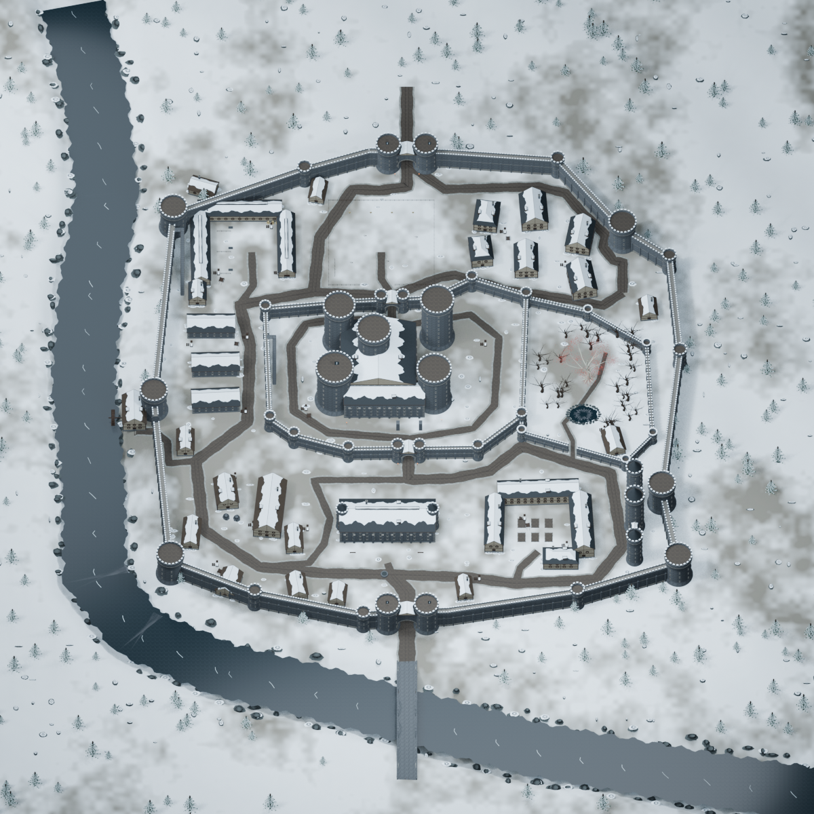
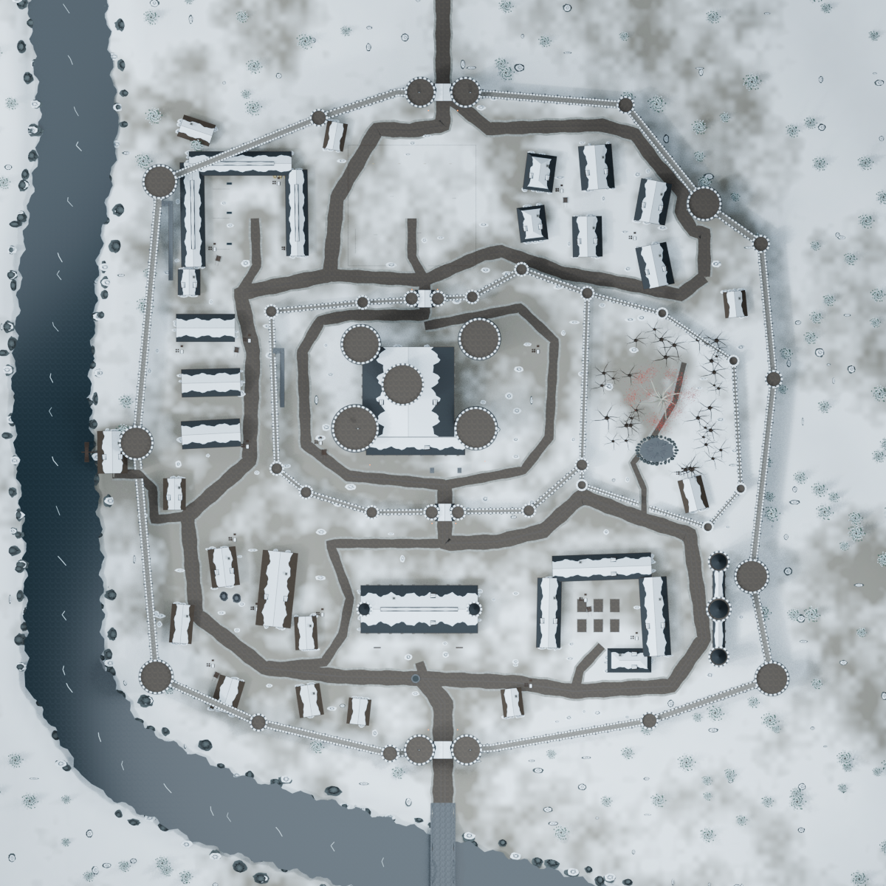
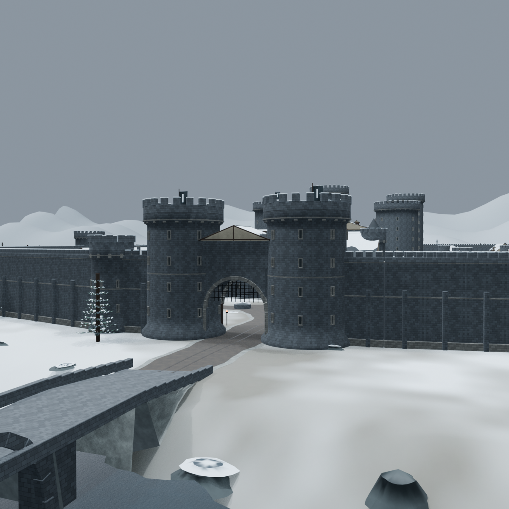
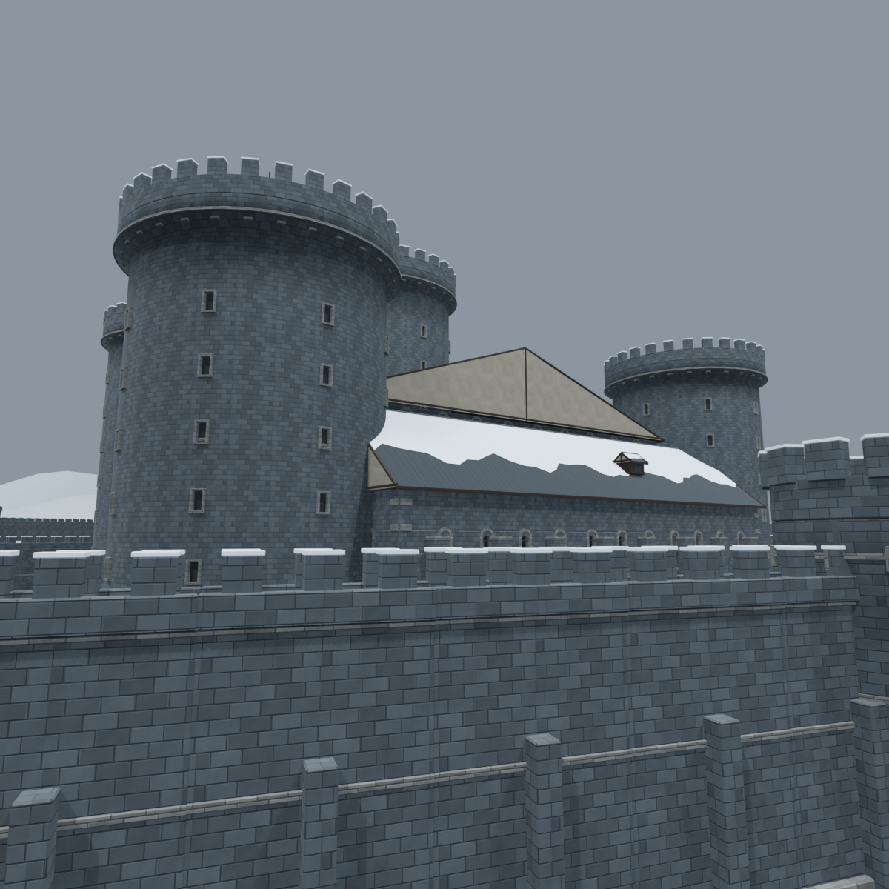
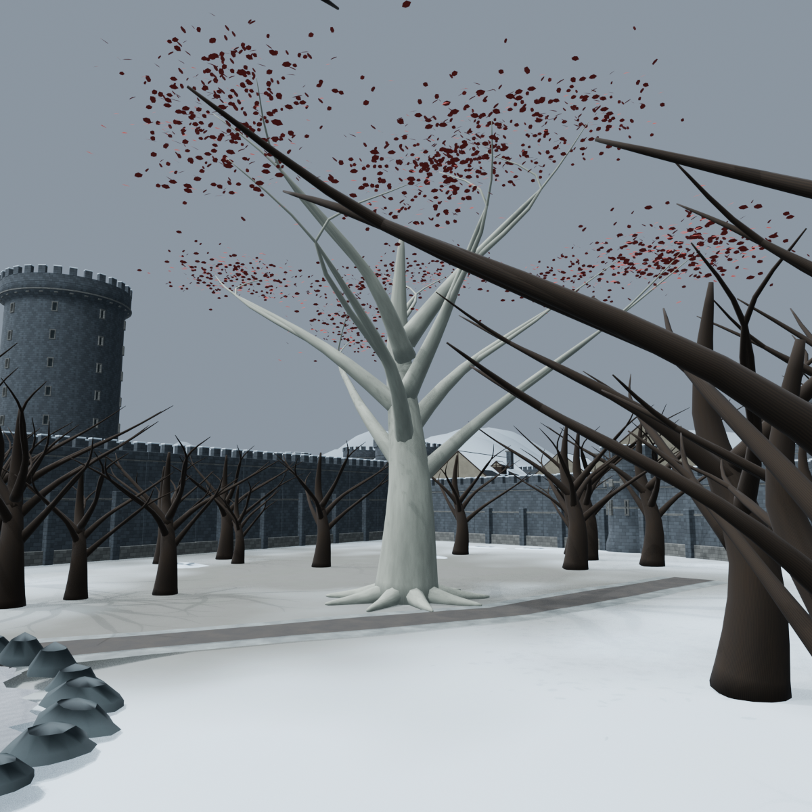
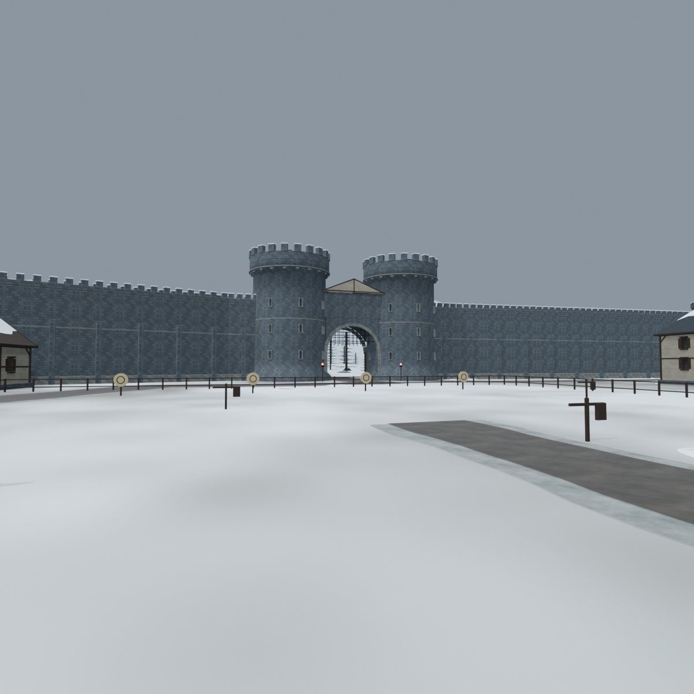
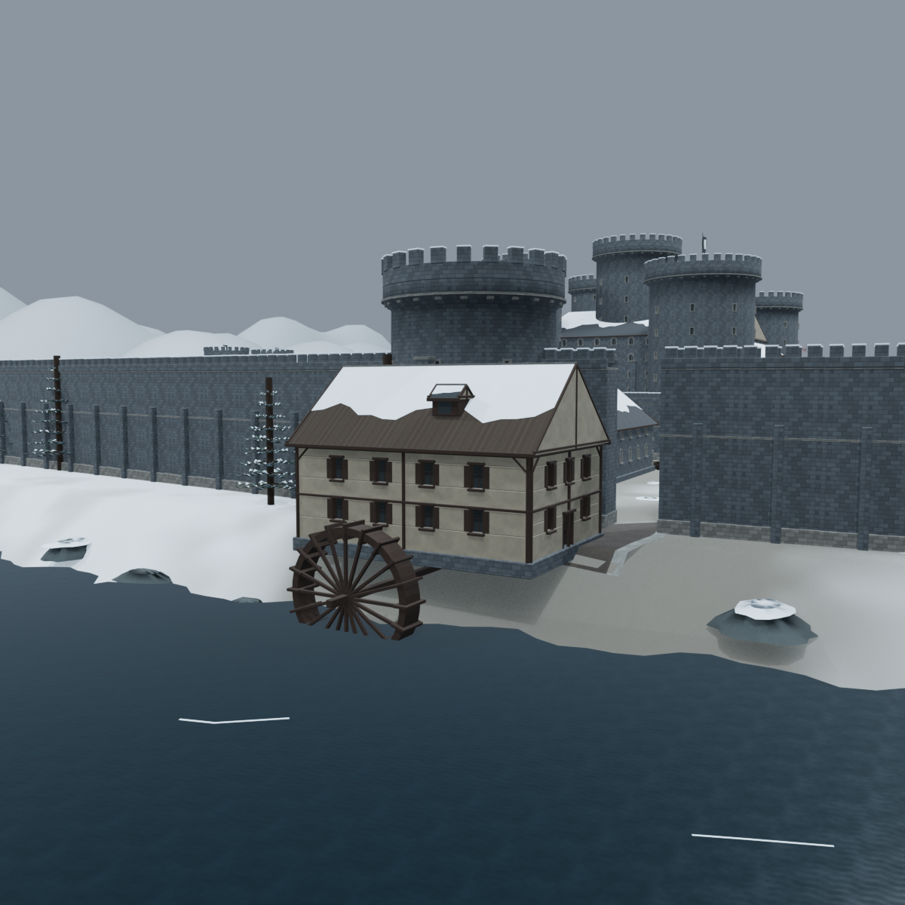
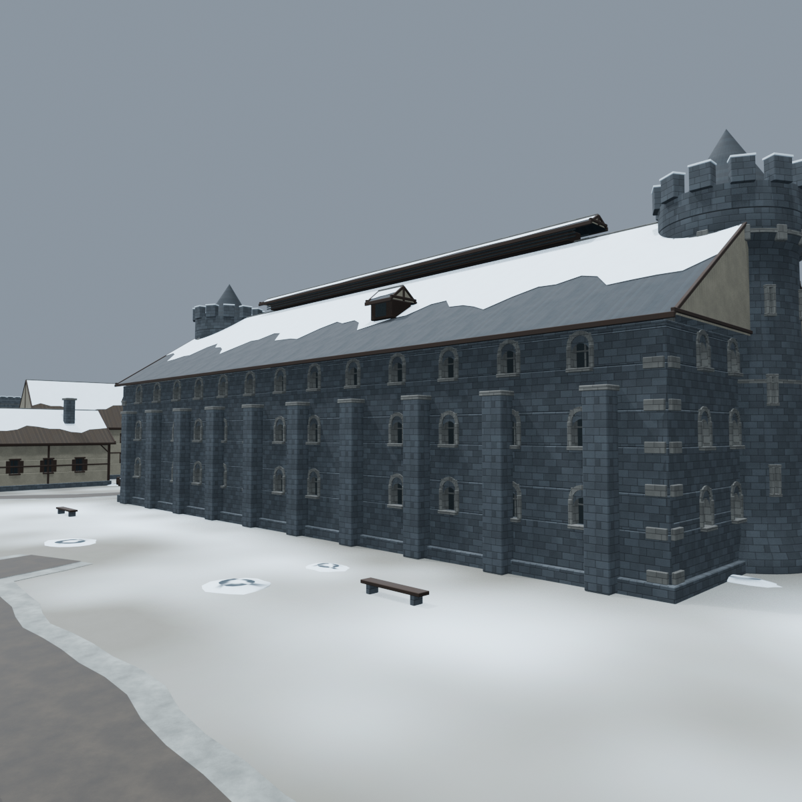

# Winterfell · Image A reconstruction

This pass replaces the rectangular prototype with a new site plan interpreted from the supplied illustration. The earlier scenes remain available in their original review folders.

## What was rebuilt

The outer enclosure is approximately 350 × 362 m, with an irregular sixteen-corner outline. A separate inner ward surrounds the Great Keep. Four functioning gate passages, a southern river bridge, a western mill postern, two wall stairs and fourteen connected road routes organize circulation.

The architecture comprises 35 buildings and 46 towers. Tower drums have battered bases, real recessed arrow openings, string courses, corbels and crenellations. Gatehouses have raised portcullises, arch voussoirs, masonry spandrels and upper chambers. Building facades have recessed doors/windows, stone surrounds or timber framing, chimneys, dormers, buttresses, roof vents and gabled/hipped roof variants. Beveled edges and exported split normals improve close views.

Base-color, normal and roughness textures are embedded in the district assets. Uneven roof snow, drifts, road wear, riverbank rocks, branch-built pines, bare woodland, a pale sacred tree with crimson leaves, a pool, carts, barrels, firewood, garden beds, training targets, troughs, torches and banners add daily-life cues.

## Match to the reference

| Reference feature | Reconstruction |
|---|---|
| North and south gates | Twin-drum entrances on the primary north/south axis |
| River and mill | Western river, southwest bend, south bridge and west-facing waterwheel |
| Northwestern stables | Three ranges around a working horse yard |
| Upper central training yard | Fenced open drill ground, targets, quintains and weapon rack |
| Northeastern guest houses | Six distinct houses with varied orientation and roofs |
| Western storehouses | Loading buildings beside the service lane and mill connection |
| Central Great Keep | Tall clustered drums and roofed ranges inside a separate irregular wall |
| Eastern Godswood | Walled woodland, pale sacred tree, red foliage and pool |
| Southwestern kitchens | Kitchen range, bakehouse, ovens and fuel stores |
| Southern Great Hall | Large separate hall with clerestory roof and stair turrets |
| Southeastern family quarters | Connected domestic ranges around garden courts |
| Maester's towers | Three slender roofed towers and a linking gallery along the east |

The drawing is an illustrated reference, not a measured survey. Proportions and circulation are interpreted in metres; the placement of the named districts and the enclosure hierarchy follow the image.

## Files and assembly

- `winterfell_reference.blend`: editable collections, packed textures, eight review cameras and native lighting.
- `public/assets/winterfell-reference/`: 23 independent GLBs, a module manifest, collision data, environment settings and source PNG textures.
- `manifest.json`: load each GLB at its `position`, at scale 1. North is browser -Z.
- `winterfell-reference-pass-05.zip`: portable review package with source, exports, generation inputs, images and checks.

The website assembles the district modules directly. Its landmark list and orthographic map view expose all eleven named districts. Draco geometry and WebP textures reduce transfer size; decoder files are served locally.

## Review images

## Remaining art polish

The layout and architecture are a substantially developed procedural environment. Further art direction can add hand-authored erosion, more varied masonry at close range, denser small branches and foliage, bespoke heraldry, animated water/smoke, occupants, animals and interiors. The illustration's exact building silhouettes, every small outbuilding and all ground clutter are not reproduced one for one. Small decorative objects use simplified collision coverage. Performance must still be profiled on the intended mobile devices; local browser measurements are recorded separately.

Validation evidence is stored beside this report: source image packing, modular GLB validation, route tests, browser screenshots and package integrity. The final measured counts and file sizes are in `manifest.json` and `export-validation.json`.
